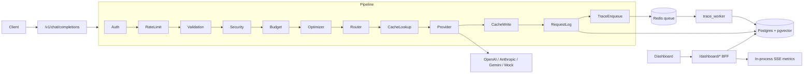

# TraceLens Architecture

TraceLens is a **single FastAPI monolith** plus **async workers** (trace + eval) and a **Next.js dashboard** (deployable to Vercel against a remote API). One OpenAI-compatible gateway path runs a **ordered pipeline**; observability data lands in Postgres and Redis. Admin APIs cover cache purge and trace DLQ recovery (`docs/admin-cache.md`).

## Request path

## Configuration

| Layer | Source | Hot reload |
|-------|--------|------------|
| Base | Environment + `.env` | Restart |
| Overlay | `config/overlay.yaml` | `POST /admin/config/reload` |
| Secrets | `ADMIN_API_TOKEN`, provider keys | Restart / admin keys API |

Routing fallback chains, shadow sampling, and mock chaos defaults can be changed via overlay without rebuilding the image.

## Differentiators (phase 14)

- **Replay:** `requests_log.request_payload` stores request + response text; `POST .../replay/{id}` re-runs the mock/provider path and returns a diff.
- **Shadow mode:** Sampled duplicate calls to a shadow model (async); sync when `X-TraceLens-Shadow-Sync: 1`.
- **Why this route:** Every JSON response includes `tracelens.routing_explanation`; streaming exposes `X-TraceLens-Routing`.
- **Savings export:** `GET /admin/tenants/{id}/reports/savings?days=7` aggregates economics rows.
- **Chaos:** Mock provider headers + `scripts/chaos_provider.py` validate circuit/fallback under failure.

## Data model (high level)

- **Tenants / API keys** — isolation boundary for all tenant-scoped tables.
- **requests_log** — per-call economics, routing explanation, replay snapshot.
- **traces / spans** — async from gateway via Redis worker.
- **prompts, datasets, experiments, evaluators, alerts** — observe plane (phase 12).

## Interview sound bites

1. **Pipeline toggles** — disable stages per env without forking code; skipped stages still audited in `tracelens.stages`.
2. **Fail-open trace enqueue** — gateway survives Redis blips; worker owns durability.
3. **Overlay config** — ops can tune routing/shadow without redeploy; env remains source of truth for secrets.