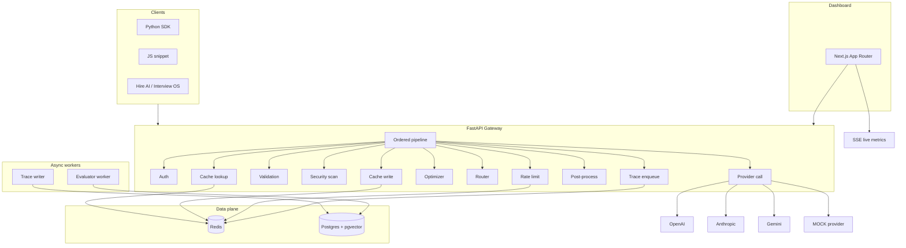

# TraceLens — Implementation Plan (STEP 0)

> **Status:** Approved — Phase 1 complete. See `PROGRESS.md`.

## Executive summary

TraceLens is built as a **single FastAPI gateway** with a **ordered, toggleable middleware pipeline**, backed by **Postgres (+ pgvector)** for durable observability state and **Redis** for hot-path cache, limits, and queues. A **Next.js dashboard** reads the same APIs. Work proceeds in **14 shippable phases**: each ends with runnable services, tests, and a narrow demo surface before the next phase adds capability.

### How execution works (after approval)

For every phase:

1. Restate goal (3 lines) → implement only listed files → tests alongside.
2. Run `ruff`, `mypy`, `pytest` (and dashboard lint/typecheck when touched).
3. Update `PROGRESS.md` → report build summary, verification steps, one interview talking point.
4. **Stop** until you say `next`.

No phase skipping, no drive-by refactors, no new dependencies without a one-line justification in the phase notes.

---

## Architecture



### Request path (happy path, cache miss)

1. **Auth** — resolve tenant + API key from `Authorization: Bearer …`, attach `tenant_id`, `key_id`.
2. **Rate limit** — per-key and per-IP (Redis sliding window; token bucket for burst where configured).
3. **Validation** — body size, schema, `max_tokens`, model allow-list per key.
4. **Security scan** — injection heuristics + pluggable classifier hook; PII detect → redact / block / log-only.
5. **Cache lookup** — exact key hash; optional semantic lookup (tenant-scoped embedding search).
6. **Optimizer** — whitespace/boilerplate, duplicate system prompt collapse, history trim (system + last N turns).
7. **Router** — health-weighted score (latency, errors, cost, eval quality); fallback chain; “why this route” inputs captured.
8. **Provider call** — retry with jittered backoff on retryable errors; circuit breaker; honor `Retry-After`.
9. **Post-process** — attach metadata (cache, optimizations, routing explanation, savings fields).
10. **Cache write** — exact (+ semantic on miss) with TTL; strict tenant namespace.
11. **Trace enqueue** — non-blocking push to Redis queue; worker persists spans + request economics row.

**NFR enforcement:** embedding model and DB failures on non-critical stages follow per-feature **fail-open vs fail-closed** from YAML config (default: semantic cache fail-open, security fail-closed).

### Major packages (logical)

| Package | Responsibility |
|--------|----------------|
| `tracelens.gateway` | HTTP routes, pipeline orchestration, SSE streaming |
| `tracelens.providers` | Adapter protocol + OpenAI / Anthropic / Gemini / MOCK |
| `tracelens.security` | Keys, limits, budgets, injection/PII |
| `tracelens.optimize` | Cache, compression, trim, cost routing, savings math |
| `tracelens.observe` | Traces, spans, prompts, datasets, evaluators, alerts |
| `tracelens.config` | Settings (Pydantic), hot-reloadable YAML overlay |
| `tracelens.workers` | Trace persistence, evaluator runs |
| `dashboard/` | Next.js UI + SSE consumers |

---

## Data model (core entities)

All tenant-owned rows include `tenant_id` (UUID). Cross-tenant queries are forbidden at the repository layer (enforced in tests).

| Entity | Purpose | Key fields |
|--------|---------|------------|
| `tenants` | Organization | `id`, `name`, `slug`, `created_at` |
| `api_keys` | Hashed secrets | `tenant_id`, `key_hash`, `prefix`, `name`, `scopes`, `allowed_models[]`, rate/budget FKs |
| `budgets` | Spend caps | `daily_tokens`, `monthly_tokens`, `daily_usd`, `monthly_usd`, `webhook_url` |
| `providers` | Provider config | `type`, `encrypted_credentials`, `enabled` |
| `routes` | Named routing policies | `fallback_chain[]`, `complexity_rules`, `min_eval_score_for_downgrade` |
| `traces` | Top-level trace | `tenant_id`, `trace_id`, `tags` (JSON), `environment` |
| `spans` | Nested work units | `trace_id`, `parent_span_id`, `kind`, `name`, `attrs`, `timestamps` |
| `requests_log` | Per LLM request economics | `tokens_in_original`, `tokens_in_final`, `tokens_out`, `cost_actual`, `cost_without_optimization`, `cache_status`, `optimizations_applied`, `routing_explanation` (JSON) |
| `prompt_versions` | Versioned templates | `prompt_id`, `version`, `template`, `metadata` |
| `datasets` / `dataset_items` | Eval data | snapshot of logged requests |
| `experiments` | Batch runs | `dataset_id`, `model`, `prompt_version_id`, `results` |
| `evaluators` / `eval_runs` | Async scoring | regex, JSON schema, LLM-judge, budgets |
| `feedback` | User thumbs | linked to `request_id` |
| `cache_entries_exact` | Optional PG audit | primary store in Redis; PG for analytics optional phase-10+ |
| `semantic_cache_index` | pgvector | `tenant_id`, `embedding`, `request_hash`, `ttl` |
| `alerts` / `alert_events` | Webhook deliveries | threshold configs |

**Embeddings:** `sentence-transformers/all-MiniLM-L6-v2` behind `EmbeddingBackend` protocol (in-process worker thread pool off hot path via `asyncio.to_thread`).

---

## Folder structure

```
Translenss/
├── docker-compose.yml
├── .env.example
├── README.md
├── ARCHITECTURE.md          # grows after phase 1
├── PLAN.md
├── PROGRESS.md
├── RESULTS.md               # phase 14 only (measured values)
├── backend/
│   ├── pyproject.toml
│   ├── alembic/
│   ├── src/tracelens/
│   │   ├── main.py
│   │   ├── config/
│   │   ├── db/
│   │   ├── gateway/
│   │   ├── pipeline/
│   │   ├── providers/
│   │   ├── security/
│   │   ├── optimize/
│   │   ├── observe/
│   │   ├── workers/
│   │   └── api/             # admin + dashboard BFF routes
│   └── tests/
│       ├── unit/
│       ├── integration/
│       └── load/            # locust scenarios (later)
├── sdk/
│   ├── python/tracelens_sdk/
│   └── js/tracelens-snippet.ts
├── dashboard/
│   ├── package.json
│   ├── src/app/
│   └── src/components/
├── scripts/
│   ├── chaos_provider.py
│   ├── benchmark.py
│   └── demo_traffic.py
└── .github/workflows/ci.yml
```

---

## Phases (14)

Each phase: **Goal** | **Tasks** | **Files touched** | **Acceptance** | **Required tests**

---

### Phase 1 — Foundation & local stack

**Goal:** Empty repo becomes a typed Python 3.12 monorepo with Docker Compose (Postgres+pgvector, Redis), health API, CI skeleton.  
**Tasks:** `pyproject.toml` (FastAPI, httpx, SQLAlchemy 2, Alembic, redis, pydantic-settings); `GET /health`; Compose wiring; `.env.example`; ruff+mypy+pytest in GHA.  
**Files:** `docker-compose.yml`, `backend/pyproject.toml`, `backend/src/tracelens/main.py`, `backend/src/tracelens/config/settings.py`, `.github/workflows/ci.yml`, `.env.example`  
**Acceptance:** `docker compose up` → `curl /health` returns 200; CI green on empty test suite.  
**Tests:** `test_health.py` (async client).

---

### Phase 2 — Data layer & tenant isolation

**Goal:** Core SQLAlchemy models, Alembic initial migration, async session pattern, repository base that always filters by `tenant_id`.  
**Tasks:** `tenants`, `api_keys` (hash only), `traces`/`spans` stubs; pgvector extension migration; Redis connection helper.  
**Files:** `backend/src/tracelens/db/*`, `alembic/versions/001_initial.py`, `tests/unit/test_tenant_isolation.py`  
**Acceptance:** Migrations apply on fresh DB; isolation tests prove cross-tenant read/write blocked.  
**Tests:** Tenant isolation (mandatory), model CRUD smoke.

---

### Phase 3 — API keys & auth pipeline stage

**Goal:** Admin API to create/list/revoke keys (hashed); gateway resolves bearer token → tenant context.  
**Tasks:** bcrypt/argon2 hash (pick argon2 via `argon2-cffi` — justification: OWASP default for password-like secrets); first pipeline stage `AuthStage`.  
**Files:** `security/keys.py`, `pipeline/stages/auth.py`, `api/admin_keys.py`  
**Acceptance:** Invalid key → 401 OpenAI-shaped body; valid key attaches `tenant_id` on internal context.  
**Tests:** Key hash never stored raw; auth integration tests.

---

### Phase 4 — Pipeline framework & MOCK gateway (non-streaming)

**Goal:** Ordered, toggleable pipeline executor; `POST /v1/chat/completions` against MOCK only; structured request context.  
**Tasks:** `Pipeline`, `Stage` protocol, stage registry from config; MOCK adapter (latency, error rate, 429 simulation); minimal trace enqueue stub (no-op queue).  
**Files:** `pipeline/*`, `providers/mock.py`, `gateway/chat.py`, `providers/base.py`  
**Acceptance:** Client can complete chat against MOCK; pipeline order enforced in tests; toggling stage off skips it.  
**Tests:** `respx` not needed yet; MOCK statistical behavior tests with seeded RNG.

---

### Phase 5 — Multi-provider adapters & models listing

**Goal:** OpenAI-compatible forwarding for OpenAI, Anthropic, Gemini adapters; `GET /v1/models`.  
**Tasks:** Normalize request/response to internal `ChatRequest`/`ChatResponse`; encrypted provider creds at rest (Fernet from env master key).  
**Files:** `providers/openai.py`, `anthropic.py`, `gemini.py`, `gateway/models.py`  
**Acceptance:** With real keys in `.env`, list models and one non-stream completion per provider (skipped in CI via markers).  
**Tests:** Contract tests with recorded fixtures; adapter unit tests with httpx mock transport.

---

### Phase 6 — Streaming SSE & provider stage hardening

**Goal:** Streaming `chat/completions` end-to-end; provider stage integrates retry placeholders (full retry in phase 8).  
**Tasks:** SSE generator; stream-through MOCK and OpenAI-shaped chunk format; cancel on client disconnect.  
**Files:** `gateway/streaming.py`, updates to `chat.py`, `providers/base.py`  
**Acceptance:** `stream: true` returns valid SSE; gateway overhead measurable in tests (baseline).  
**Tests:** Streaming integration test; disconnect handling.

---

### Phase 7 — Rate limits, validation, security scan

**Goal:** Redis sliding-window limits (per key + per IP); payload validation; injection heuristics + PII modes (pluggable hook).  
**Tasks:** `RateLimitStage`, `ValidationStage`, `SecurityScanStage`; config for fail-open/closed per feature.  
**Files:** `security/rate_limit.py`, `security/validation.py`, `security/injection.py`, `security/pii.py`  
**Acceptance:** 429 with OpenAI body on limit; oversize → 400; PII block/redact modes behave per config.  
**Tests:** Multi-tenant cache key namespace; limit window tests (fake Redis / docker).

---

### Phase 8 — Health, circuit breaker, retries, fallback routing

**Goal:** Rolling-window stats per provider/model; circuit breaker; jittered backoff; weighted router + fallback chain; `/health`, `/health/providers`.  
**Tasks:** Redis-backed stats; `CircuitBreaker`; `ProviderCallStage` retries; `RouterStage` v1 (latency/error weights; eval hook stub).  
**Files:** `gateway/health.py`, `optimize/routing.py`, `pipeline/stages/provider_call.py`, `pipeline/stages/router.py`  
**Acceptance:** MOCK chaos → breaker opens; fallback serves without client error; health endpoints expose state.  
**Tests:** Breaker state machine; fallback integration; honors `Retry-After`.

---

### Phase 9 — Budgets & economics row

**Goal:** Per-key daily/monthly token and USD budgets (hard stop + 80% webhook); persist `requests_log` economics skeleton on every gateway call.  
**Tasks:** Budget counter in Redis with PG reconcile; webhook sender (httpx background task); OpenAI error mapping table.  
**Files:** `security/budgets.py`, `observe/request_log.py`, `gateway/errors.py`  
**Acceptance:** Budget exceeded → hard stop; warning webhook fires once per threshold window.  
**Tests:** Budget accumulation; reproducible cost fields from stored row (zeros until phase 10 optimizations).

---

### Phase 10 — Caching & cost optimization

**Goal:** Exact + semantic cache (tenant-isolated), prompt compression + history trim, cost-aware routing with safe-downgrade rule, full savings math.  
**Tasks:** `CacheLookupStage`/`CacheWriteStage`; pgvector semantic index; `OptimizerStage`; complexity heuristic; headers `X-TraceLens-Cache-Bypass`, routing override.  
**Files:** `optimize/cache.py`, `optimize/semantic.py`, `optimize/compress.py`, `embeddings/backends/minilm.py`  
**Acceptance:** Repeat prompt → cache hit; semantic near-dup hits at ≥0.92; `cost_without_optimization - cost_actual` matches stored columns.  
**Tests:** **Mandatory** cross-tenant semantic cache isolation; savings reproducibility test.

---

### Phase 11 — Observability core (traces, metrics, SDK)

**Goal:** Full span tree persistence via queue worker; Prometheus `/metrics`; structured JSON logs; Python SDK decorator/context manager.  
**Tasks:** Trace worker consumer; span CRUD; W3C/trace_id propagation; `tracelens_sdk` package.  
**Files:** `observe/traces.py`, `workers/trace_worker.py`, `observe/metrics.py`, `sdk/python/*`  
**Acceptance:** Gateway enqueue does not block request path (p95 enqueue < 2ms in unit simulation); SDK creates child spans.  
**Tests:** Queue fail-open; span parent/child integrity; metrics counters increment.

---

### Phase 12 — Prompts, datasets, experiments, evaluators, alerts

**Goal:** Versioned prompts with per-version metrics; dataset from logged requests; experiment runner; async evaluators (regex, JSON schema, LLM-judge optional); alert webhooks.  
**Tasks:** Eval worker; experiment batch job API; prompt compare API; quality score fed back to router (phase 8 extension).  
**Files:** `observe/prompts.py`, `datasets.py`, `experiments.py`, `evaluators.py`, `workers/eval_worker.py`  
**Acceptance:** Run experiment on small dataset → side-by-side results; evaluator updates route quality score; alert fires on mocked spike.  
**Tests:** Eval async; prompt version metrics aggregation.

---

### Phase 13 — Dashboard (Next.js)

**Goal:** App Router dashboard: Overview (SSE live), Providers, Cost, Security, Trace Explorer, Prompts, Datasets/Experiments, Alerts, Settings.  
**Tasks:** Tailwind + Recharts; BFF calls to FastAPI admin/read APIs; SSE for live req/s and success rate.  
**Files:** `dashboard/**`, `backend/src/tracelens/api/dashboard.py`  
**Acceptance:** `docker compose up` shows dashboard on seeded demo tenant; trace tree renders; circuit state visible.  
**Tests:** Minimal Playwright or API contract tests (optional); TypeScript `tsc` clean.

---

### Phase 14 — Differentiators, dogfooding, proof & docs

**Goal:** Replay, shadow mode, “why this route?” on every response, weekly savings export, hot-reload YAML + admin API; Hire AI / Interview OS integration guides; chaos + benchmark scripts; `RESULTS.md` from real traffic only; README + ARCHITECTURE interview prep.  
**Tasks:** `scripts/chaos_provider.py`, `benchmark.py`, `demo_traffic.py`; seed data; Mermaid in README; 60s pitch + resume bullets template in RESULTS.  
**Files:** `scripts/*`, `README.md`, `ARCHITECTURE.md`, `docs/integrations/*.md`, `RESULTS.md`  
**Acceptance:** Chaos demo: circuit opens, failover, zero client errors; benchmark table printed; compose seed makes demo self-contained.  
**Tests:** Replay diff test; shadow sampling test; config hot-reload test.

---

## Phase dependency graph (simplified)

```
1 → 2 → 3 → 4 → 5 → 6
              ↓
        7 → 8 → 9 → 10
              ↓
        11 → 12 → 13 → 14
```

Phases 7–9 can be reordered with 8 only if router retries are stubbed in 6 (default order above keeps resilience before budgets).

---

## Risks & decisions (one line each)

| # | Risk / decision |
|---|-----------------|
| 1 | **Sliding window vs token bucket:** sliding window for fairness on sustained load; token bucket optional per key for burst — default sliding only to reduce moving parts. |
| 2 | **Semantic cache false positives:** default similarity 0.92 + tenant isolation + return similarity in metadata; bypass header for safety-critical routes. |
| 3 | **Fail-open vs fail-closed:** security default closed; cache/semantic default open; documented per stage in YAML. |
| 4 | **Gateway 15ms p95:** measure ex-provider only; embedding on semantic miss uses thread pool — may defer semantic to async post-response write on contested paths if needed. |
| 5 | **Encrypted provider keys:** Fernet with `MASTER_ENCRYPTION_KEY` env — not HSM-grade; acceptable for self-hosted OSS. |
| 6 | **Single monolith vs microservices:** one FastAPI process + workers — simpler ops; horizontal scale via replicas behind load balancer. |
| 7 | **Trace queue loss:** Redis list + worker ACK pattern; on Redis down, fail-open drop with metric counter (configurable). |
| 8 | **LLM-as-judge cost:** async only, never on gateway hot path; rate limited per tenant. |
| 9 | **Multi-tenant leakage:** repository mixin + explicit security tests every phase touching cache or traces. |
| 10 | **Provider adapter drift:** internal normalized schema; adapters own vendor quirks; contract tests per provider. |
| 11 | **Dashboard auth:** phase 13 uses same API keys + session cookie for UI login (no separate auth server). |
| 12 | **pgvector size:** semantic index per tenant partition via `tenant_id` btree + vector index scoped in queries. |
| 13 | **MOCK provider in prod:** disabled by default; only enabled in dev/CI via config. |
| 14 | **Dogfooding RESULTS:** no fabricated numbers — placeholders until real Hire AI / Interview OS traffic. |

---

## Dependency additions (anticipated, justified per phase)

| Phase | Dependency | One-line justification |
|-------|------------|-------------------------|
| 2 | `asyncpg`, `pgvector` | Async Postgres + semantic index storage. |
| 3 | `argon2-cffi` | Secure API key hashing. |
| 5 | `cryptography` | Fernet encryption for provider credentials at rest. |
| 10 | `sentence-transformers` | Local embeddings without paid API for semantic cache. |
| 11 | `prometheus-client` | Standard `/metrics` exposition. |
| 13 | `recharts` (npm) | Dashboard charts per spec. |

---

## Approval checklist

- [ ] Phase count (14) and order acceptable  
- [ ] Architecture and folder layout acceptable  
- [ ] Data model sufficient for MVP → differentiators  
- [ ] Risks/tradeoffs documented enough for interview prep  

**After approval:** begin Phase 1 only on your `next` command.