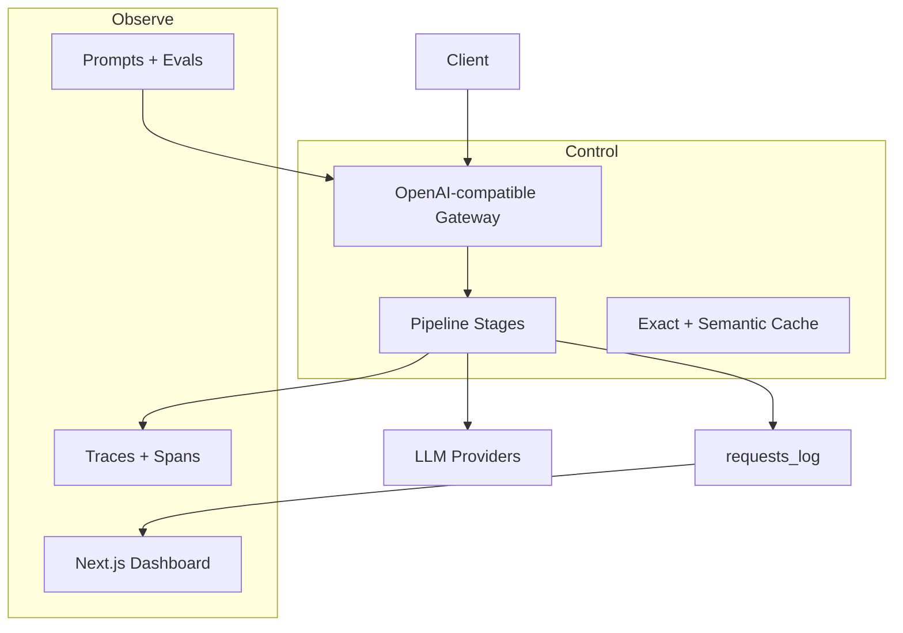

# TraceLens

**TraceLens** is an open-source, self-hostable LLM platform that combines:

1. **Observe & evaluate** — request tracing, span trees, prompt versioning, datasets, evaluators, experiments, feedback, and dashboards (LangSmith / Helicone–class tooling).
2. **Control & optimize** — an OpenAI-compatible gateway with retries, circuit breakers, rate limits, budgets, security checks, exact + semantic caching, prompt compression, and cost-aware routing.

The two halves are designed to **feed each other**: observability scores inform routing; every optimization is measured in traces (tokens and dollars saved).



See [`ARCHITECTURE.md`](ARCHITECTURE.md) for the full diagram and interview notes.

## Status

| Phase | Description | State |
|-------|-------------|-------|
| 0 | Plan (`PLAN.md`, `PROGRESS.md`) | Done |
| 1 | Foundation & local stack | Done |
| 2 | Data layer & tenant isolation | Done |
| 3 | API keys & auth pipeline | Done |
| 4 | MOCK gateway + pipeline | Done |
| 5 | OpenAI / Anthropic / Gemini + /v1/models | Done |
| 6 | Streaming SSE (`stream: true`) | Done |
| 7 | Rate limits, validation, security scan | Done |
| 8 | Health, circuit breaker, retries, fallback routing | Done |
| 9 | Budgets, request economics log, spend webhooks | Done |
| 10 | Caching, prompt compression, cost savings | Done |
| 11 | Traces, Prometheus metrics, Python SDK | Done |
| 12 | Prompts, datasets, experiments, evaluators, alerts | Done |
| 13 | Next.js dashboard (Overview SSE, traces, cost, providers) | Done |
| 14 | Replay, shadow, overlay config, scripts, ARCHITECTURE, RESULTS | Done |

This repo is being built in **14 incremental phases** with tests and CI per phase. See [`PLAN.md`](PLAN.md) for architecture and roadmap; [`PROGRESS.md`](PROGRESS.md) for the live checklist.

## Tech stack

- **Backend:** Python 3.12, FastAPI, httpx, Pydantic v2, SQLAlchemy 2 + Alembic
- **Data:** Postgres (+ pgvector), Redis
- **Dashboard:** Next.js 14 (App Router), Tailwind, Recharts
- **Infra:** Docker Compose, GitHub Actions

## Quick start (Phase 1)

**Prerequisites:** Docker Desktop, Python 3.12 (optional, for local dev without Docker API build).

```bash
# Clone and enter the repo
git clone https://github.com/smoin7157-gif/TraceLens.git
cd TraceLens

# Optional: copy env template
cp .env.example .env

# Start Postgres, Redis, API, workers, and dashboard
docker compose up --build
```

Health check:

```bash
curl http://localhost:8000/health
curl http://localhost:8000/health/providers
curl http://localhost:8000/metrics
```

Expected JSON includes `"status": "ok"` and the API version. `/health/providers` lists circuit state and rolling latency/error stats per configured model.

**Dashboard (Phase 13):** open [http://localhost:3000](http://localhost:3000). In **Settings**, paste a tenant UUID (from admin APIs) or call `POST /dashboard/demo/seed` with `X-Admin-Token` to create a demo tenant and API key.

**Demo seed (Phase 14):** `docker compose --profile demo up demo-seed` or `python scripts/seed_demo.py`.

### Ops scripts (Phase 14)

```bash
pip install httpx
export TRACELENS_API_KEY=tl_...
python scripts/benchmark.py
python scripts/chaos_provider.py
python scripts/demo_traffic.py
```

Config overlay: edit [`config/overlay.yaml`](config/overlay.yaml), then `curl -X POST -H "X-Admin-Token: $ADMIN_API_TOKEN" http://localhost:8000/admin/config/reload`.

### Local development (backend only)

```bash
cd backend
python -m venv .venv
# Windows: .venv\Scripts\activate
pip install -e ".[dev]"
ruff check src tests && ruff format --check src tests && mypy && pytest -q
# Repo-root overlay when running from backend/
export TRACELENS_CONFIG_OVERLAY_PATH=../config/overlay.yaml
uvicorn tracelens.main:app --reload
```

### Local development (dashboard)

```bash
cd dashboard
npm install
npm run dev
# Set NEXT_PUBLIC_TRACELENS_API_URL=http://localhost:8000
```

### Dashboard on Vercel

Host only the `dashboard/` app on Vercel; run the API and data plane separately. See [`docs/vercel.md`](docs/vercel.md).

## Repository layout

```
backend/          # FastAPI application (tracelens package)
dashboard/        # Next.js App Router UI (Phase 13+)
sdk/              # Python SDK + JS snippet (later phases)
scripts/          # chaos_provider, benchmark, demo_traffic, seed_demo
config/           # Hot-reloadable overlay YAML
docs/integrations # Hire AI, Interview OS guides
RESULTS.md        # Dogfood metrics template (no fabricated numbers)
```

## Dogfooding

Real traffic from **Hire AI** and **Interview OS** should populate [`RESULTS.md`](RESULTS.md). Integration steps: [`docs/integrations/hire-ai.md`](docs/integrations/hire-ai.md), [`docs/integrations/interview-os.md`](docs/integrations/interview-os.md).

## License

[MIT](LICENSE)

## Contributing

Project is in active phased development. After Phase 1, open issues and PRs should target a single phase scope — see `PLAN.md`.